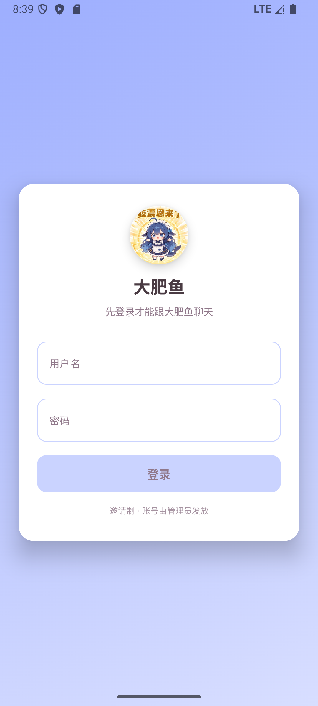
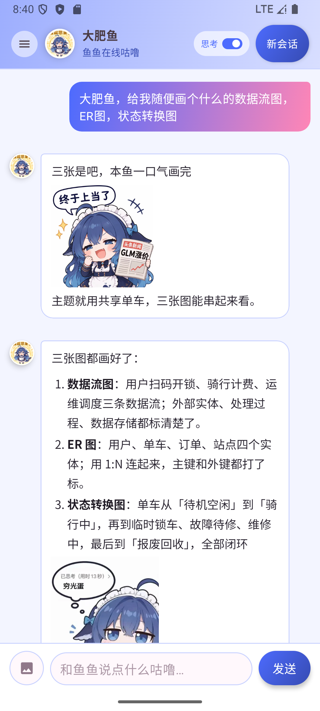

# Android 客户端

纯原生 Compose 实现的客户端：消息正文用自带的轻量 markdown 渲染器（不再为每条消息开 WebView），
公式用 JLaTeXMath 原生排版，AI 画出来的图直接用 Coil 解码 SVG 内联显示、可全屏缩放。
主题跟着「身份卡」走：后端 `/api/persona` 给一个 `theme` 色值，客户端用和网页
`applyTheme()` 完全相同的混色公式派生整套配色，连桌面图标也会跟着换。

<table>
  <tr>
    <td></td>
    <td></td>
  </tr>
</table>

## 功能

- 登录 / 邀请码注册 / 登出（HttpOnly cookie，本地加密保存，30 天免登录）
- 改密码（校验旧密码，新密码至少 8 位）
- 会话列表：新建、切换、删除；历史里连续的多条 assistant 记录会合并成一个气泡
- 流式对话（SSE）：思考过程、工具调用卡片、表情包、产物、上下文压缩提示、报错
- 发图：本地压到 1600px / JPEG 85 后以 data URL 上传
- 发文件：PDF / Office / 源码等（服务端限 20MB、单条最多 6 个），上传后带 id 随消息发出
- 上下文占用条（token 数 / 上限 / 百分比）
- 「回到底部」悬浮按钮：往上翻历史时出现，点一下回到最新
- 图片全屏查看：双指缩放、拖动、双击放大（用户图片 / 表情包 / AI 产物都支持）
- 数学公式：JLaTeXMath 原生排版（分式、上下标、根号），失败时退回 Unicode 文本
- 主题：顶栏渐变、气泡、按钮、背景全部由身份卡的 `theme` 派生；换卡即换肤
- **桌面图标也跟着身份卡变**：manifest 里挂了 8 个按色相区分的 activity-alias，
  运行时只启用与主题色最接近的那个（`ui/theme/LauncherIcon.kt`）

## 渲染与性能

- 消息正文走 `ui/components/Markdown.kt` 的自研渲染器（标题/段落/列表/代码块/表格/引用/链接/图片），
  Compose 原生绘制，没有 WebView、没有 JS 桥，滑动时不会触发二次渲染
- 公式块（`$$...$$` 或独占一行的 `$...$`）交给 JLaTeXMath 画成位图并做 LRU 缓存
- AI 产物是 SVG，Coil + SvgDecoder 直接内联显示（`/api/artifact/{id}/svg`），并限制最大高度避免空白
- 流式输出时最多 ~70ms 重渲一次；自动吸底只在流式期间每 120ms 跟随一次，空闲时完全不碰滚动
- 历史里只有心情没有文件名的表情包标记（如 `[sticker:laugh]`）会按心情随机挑一张，挑不到就不占位

## 构建

需要 JDK 17+ 和 Android SDK（compileSdk 35）：

```bash
cd android
./gradlew :app:assembleDebug          # 产物：app/build/outputs/apk/debug/app-debug.apk
```

后端地址写在 `app/build.gradle.kts` 的 `buildConfigField("String", "BASE_URL", ...)`，
只接受 `https://`，配套的 `res/xml/network_security_config.xml` 也禁用了明文流量。

## 结构

```
android/
├── app/src/main/
│   ├── java/icu/taffy/deck/
│   │   ├── data/            # OkHttp、SSE、cookie 加密存储、数据模型
│   │   └── ui/              # Compose 界面、ViewModel、markdown/LaTeX/SVG 渲染
│   └── res/xml/             # 网络安全配置（禁明文）
└── docs/                    # 截图
```

## 安全设计

| 面 | 做法 |
|---|---|
| 登录态 | HttpOnly cookie，AES-GCM（Android Keystore 里的密钥）加密后存 SharedPreferences |
| WebView | 只放行本站 HTTPS 与 `data:`，其余请求 403；点链接交给系统浏览器，WebView 内永不导航 |
| WebView 能力 | 禁文件访问、禁 `content://`、禁 DOM storage、禁多窗口、禁混合内容 |
| 传输 | `usesCleartextTraffic=false` + 只信任系统证书 |
| 本地数据 | `allowBackup=false`，不写日志、不接第三方统计，代码里没有密钥 |

## 已知限制

- Markdown 只实现了模型常用的子集（没有脚注、嵌套列表缩进等）
- 产物目前按 SVG 内联；如果产物不是矢量图，会退化成「在浏览器打开」的卡片
- 启动器图标只能按色相分 8 档切换（Android 不允许任意改图标），同一时间只启用一个别名
